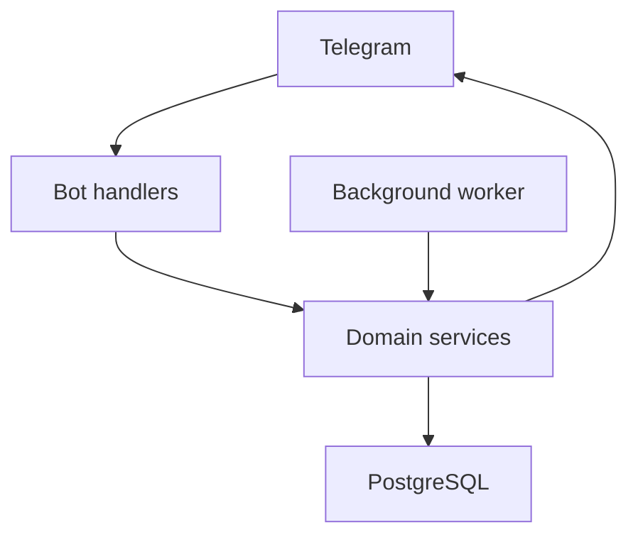

# CoachFlow

A Telegram application for coaches and clients to manage training bookings and meal-report feedback.

The current application uses Python 3.12, aiogram, async SQLAlchemy, PostgreSQL, and Alembic. A separate worker handles reminders and scheduled meal check-ins.

## Current implementation

- Invite-based client registration and privacy consent.
- Coach availability, client booking, cancellation, and schedule management.
- Meal-photo reports, coach reviews, and clarification responses.
- Appointment reminders, scheduled meal check-ins, and notification logging.
- Calendar export as `.ics` files.
- Privacy-related services, including data deletion requests and retention of photo references.
- Service tests covering bookings, schedules, meal reports, privacy, notifications, and calendar exports.

The original planning document is preserved in [the historical project brief](docs/project-brief.md). It includes proposals and assumptions that do not describe the current implementation.

## Architecture



| Location | Responsibility |
| --- | --- |
| `app/bot/` | Telegram handlers, callbacks, keyboards, and conversation state |
| `app/services/` | Booking, client management, meal reports, notifications, privacy, and calendar export |
| `app/db/` | SQLAlchemy models and asynchronous database sessions |
| `app/workers/` | Periodic reminder, check-in, and retention tasks |
| `alembic/` | Database migrations |
| `tests/services/` | Service-level tests |

The bot runs with long polling. The worker is a separate process. Meal-photo records currently retain Telegram file identifiers; the S3/object-storage ideas in the historical brief are not an implemented upload pipeline. Calendar export produces files, not live calendar synchronization.

## Local setup with Docker Compose

Requirements: Git, Docker with Compose, a Telegram bot token, and the numeric Telegram ID of the coach account.

```bash
git clone https://github.com/cvrs3d/CoachFlow.git
cd CoachFlow
cp .env.example .env
```

Edit `.env` before starting the services:

| Variable | Purpose |
| --- | --- |
| `BOT_TOKEN` | Token of the Telegram bot used for this environment |
| `POSTGRES_DB`, `POSTGRES_USER`, `POSTGRES_PASSWORD` | PostgreSQL database and credentials |
| `DATABASE_URL` | Async SQLAlchemy URL matching those credentials; use host `postgres` inside Compose |
| `APP_ENV` | Application environment, default `dev` |
| `CLIENT_CANCELLATION_DEADLINE_HOURS` | Cancellation cutoff, default `24` |

Use a separate bot and database for development. The default Compose file publishes PostgreSQL on host port 5432; adjust the binding if needed for your machine.

Build the application image, start PostgreSQL, and wait until the database is healthy:

```bash
docker compose build bot worker
docker compose up -d postgres
docker compose ps
```

Apply migrations before starting the bot or worker:

```bash
docker compose run --rm bot alembic upgrade head
```

Create or update the coach account, replacing the example numeric ID and username with your own:

```bash
docker compose run --rm bot python -m app.scripts.seed_coach 123456789 your_username
```

Start the application:

```bash
docker compose up -d bot worker
docker compose logs --tail=50 bot worker
```

Open the bot in Telegram as the seeded coach and send `/start`. Use the coach menu to create an invite for a separate client account.

## Tests

The service test fixtures create a temporary SQLite database at `tests/test.db`. Configure the application for an isolated test run as well:

```bash
python3.12 -m venv .venv
source .venv/bin/activate
python -m pip install -r requirements.txt

BOT_TOKEN=123456789:test-token \
DATABASE_URL=sqlite+aiosqlite:///:memory: \
python -m pytest -q
```

These service tests do not establish PostgreSQL concurrency behavior or validate a live Telegram deployment. Exercise those separately with a development bot and database. The existing [smoke-test checklist](docs/smoke_test.md) describes manual flows; its backup/restore script references are deployment prerequisites and those scripts are not included in this repository.

## Scope and limitations

- Calendar exports do not automatically synchronize changes to Google Calendar or other calendar services.
- There is no implemented S3 upload pipeline, billing integration, or web administration UI.
- Background jobs run in a single worker process; distributed scheduling and delivery guarantees require separate validation.
- Production readiness, backup/restore, and operational monitoring require deployment-specific work.
